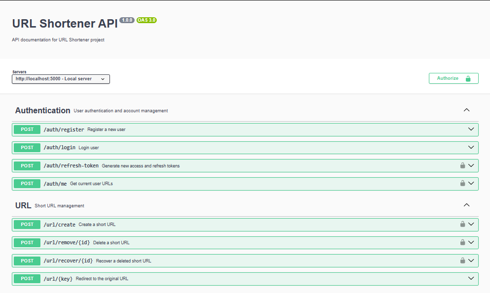

# 🔗 URL Shortener

A RESTFUL URL Shortener API built with Node.js, Express.js, Sequelize, and MySQL.
## 📸 Preview



## 🚀 Features

- User Registration & Authentication
- JWT Authentication (Access & Refresh Tokens)
- Google OAuth Authentication with Passport.js
- Secure Password Hashing with Bcrypt
- URL Shortening
- Custom Short URLs
- URL Redirection
- User URL Management
- Soft Delete & URL Recovery
- Request Validation with Yup
- Database Migration Management
- API Documentation with Swagger

## 🛠 Tech Stack

| Technology | Purpose |
|---|---|
| Node.js | Runtime Environment |
| Express.js | Backend Framework |
| MySQL | Relational Database |
| Sequelize | ORM |
| Passport.js | Authentication |
| JWT | Token Authentication |
| Bcrypt | Password Hashing |
| Yup | Data Validation |
| Swagger | API Documentation |

## 📦 Installation

1. Clone the repository:

```bash
git clone https://github.com/amirmohammadmalakotie/url-shortener.git
```

2. Navigate to the project directory:

```bash
cd url-shortener
```

3. Install dependencies:

```bash
npm install
```

4. Create a `.env` file in the root directory and configure your environment variables.

5. Configure your MySQL database connection.

## 🗄 Database Migrations

This project uses Sequelize migrations to manage database schema changes.

### Run Migrations

Apply database migrations:

```bash
npm run migrate
```

### Undo Migrations

Remove database migrations:

```bash
npm run undo-migrate
```

**Note:** Undoing migrations may remove database tables and columns. Make sure to back up important data before running this command.

## ▶️ Running the Project

Start the development server:

```bash
npm run dev
```

## 📚 API Documentation

API documentation is available through Swagger UI:

```text
/api-docs
```

## 🔐 Environment Variables

Create a `.env` file and configure the required environment variables.

Make sure not to commit your `.env` file or expose sensitive credentials.

## 👨‍💻 Developer

**Amir Mohammad**

Full Stack Web Developer

- GitHub: [@amirmohammadmalakotie](https://github.com/amirmohammadmalakotie)

---

⭐ If you find this project useful, consider giving it a star!
